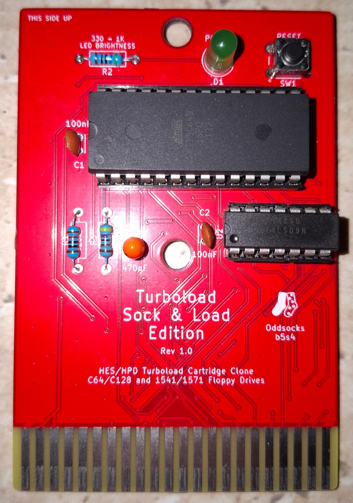
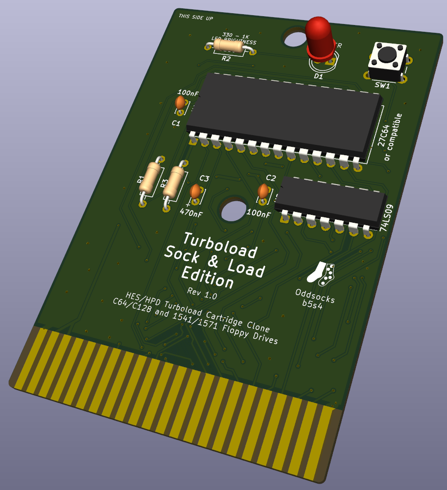
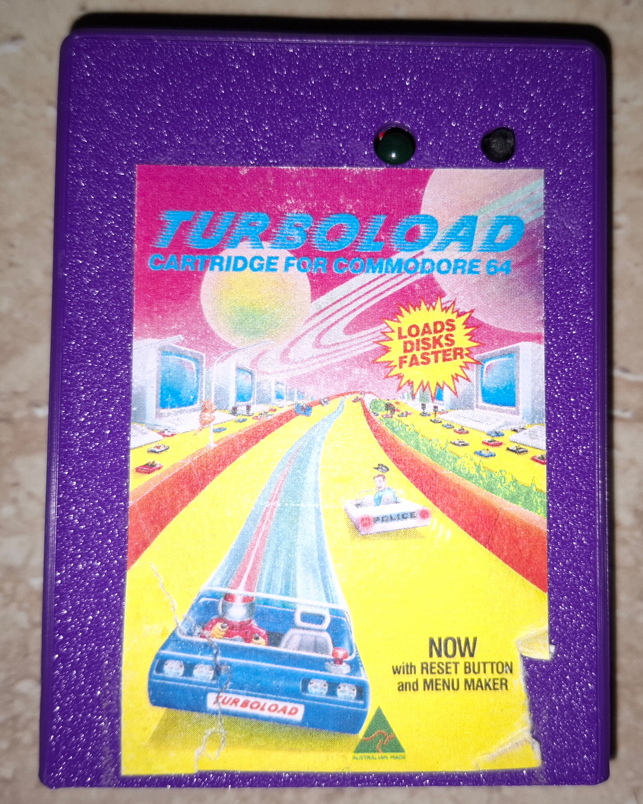

# TurboLoad Sock & Load Edition

## Description
A clone of the Australian designed C64 HES/HPD Turboload Cartridge for C64 Disk Drives

**Features**
* Speeds up the load of floppy disks by up to 6 times
* Adds additional DOS commands
* Reset Button
* Power LED
* Compatible with the JACC64 case

## Bill of Materials

| Qty | Component                    |
|:---:|------------------------------|
| 1   | 470nF Tantalum Capacitor     |
| 2   | 100nF Ceramic Capacitors     |
| 1   | 5mm LED                      |
| 1   | 330Ω Axial Resistor (LED)    |
| 1   | 4.7KΩ Axial Resistor         |
| 1   | 10KΩ Axial Resistor          |
| 1   | 6mm Tactile Switch           |
| 1   | 74LS09 14pin DIP             |
| 1   | 27C64 or compatible (E)EPROM |

* IC sockets optional.
* The LED resistor is nominally 330Ω but anything up to 1K usually is fine
* Larger EPROMS/EEPROMS can generally be used but repeat the image to fill up the ROM

## 3D Printable Case
This PCB is designed to be compatible with the case for the JACC64-16K cartridge. Please see that repository for details.

## Support Me
Everything is freely available so you can make your own PCB and case, however if you would like to support me, please see the following links.

* [My Projects](https://projects.amiga-hardware.com) - Donate on this page
* [Order the TurboLoad Sock & Load PCB]()
* [Order the JACC64-16K Case which is compatible](https://www.pcbway.com/project/shareproject/JACC64_16K_C64_Cartridge_Case_78ec0fd1.html)

